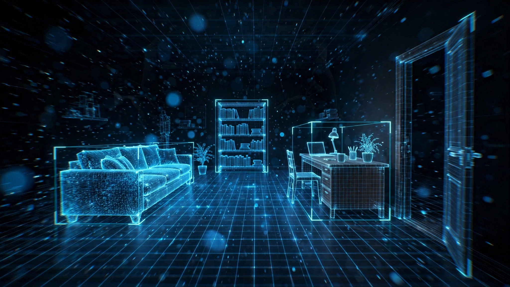

 

---

## 👋 About

我正在做 **ECHO（回声）** —— 把一段随手慢走拍下的视频，变成一个可以重新走进去的 3D 现场。

> **把生活存成可以重进的现场。**
> 记录是底片，软件是显影液：同一次记录，可以显影出空间、物体、事件，和重活一次的入口。

- 🎥 **输入只要一段视频**：慢慢走、慢慢转，把细节都拍进去——剩下的交给软件。
- 📐 **诚实是底线**：量到的就是量到的；估的标「估计」，生成的标「生成」，不知道的就写「未知」。绝不脑补。
- 🧭 **先记录，后重建**：原始记录永远保存；重建方法可以一直升级，现场不会过期。
- 🥽 **终点是眼镜**：同一条同步记录，既用来当场行动，也留给日后重进。

## 🚀 Flagship — ECHO / EchoScene

**EchoScene**（Windows 桌面软件，免费）——把视频拖进去，等它显影，拿回一个能双击打开的场景：

- 🖱️ **拖入即生成**：一段慢速环绕拍摄的视频 → 3D 场景文件 + GLB / PLY，全是本地文件，在你自己的电脑上。
- 👁️ **边生成边看**：实时预览看着场景一点点长出来，可全屏旋转缩放。
- 🔥 **热更新**：装一次底座，之后每个新版本只下几 MB，软件里自己完成。
- 📏 **真尺度**：从画面里的参照物量出真实尺寸（标「估计」，不冒充实测）。

**Echo Render** — ECHO 的配套渲染算子（引擎代号 MUS）：纯 CPU 点云/线框渲染器，不要 GPU、不要浏览器，给点和线就出图。为 ECHO 的数据规格量身定做，也开源给任何人开箱即用。

## 🧰 Also on the workbench

- 🎨 **[Pixel Studio](https://github.com/REDrighthand05/pixel-studio)** — 现代像素画编辑器：图层、动画，一应俱全。
- 🖱️ **[Screen Clicker](https://github.com/REDrighthand05/screen-clicker)** / 👁️ **[Screen OCR](https://github.com/REDrighthand05/screen-ocr)** — 让 AI 智能体能操作、能看见你的屏幕。
- 🤖 **[Pod](https://github.com/REDrighthand05/Pod)** — NieR:Automata 的 Pod，桌面上的小伙伴。

## 🛠️ Toolbox

## 📊 The numbers

<picture>
  <source media="(prefers-color-scheme: dark)" srcset="https://raw.githubusercontent.com/REDrighthand05/REDrighthand05/output/github-contribution-grid-snake-dark.svg"/>
  
</picture>

---

*Capture first. The record is the asset.*
**先把现场存下来——剩下的，交给时间显影。**

